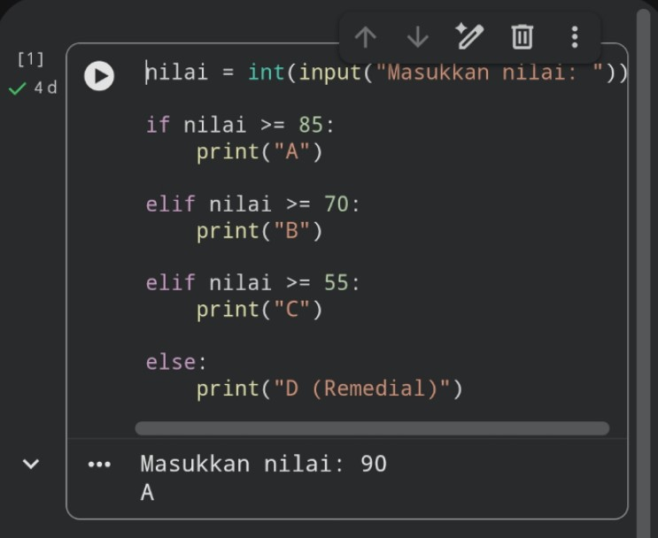
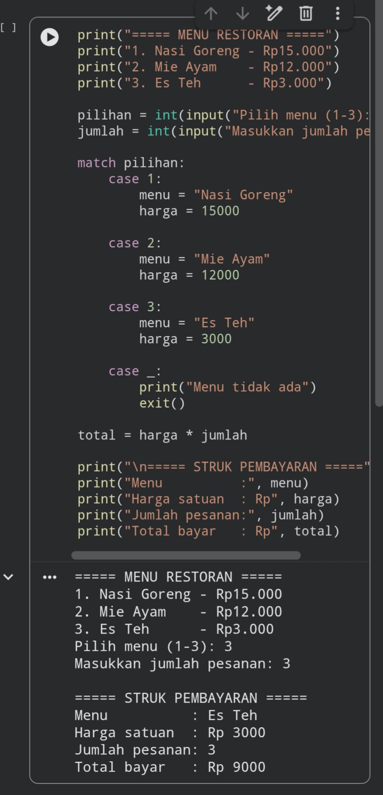

## SESION - 5 TUGAS PEMOGRAMAN ##
___
Nama : Siti Nazwa Nuralifah 

Nim : 26552011212

Kelas : Rp26F

___
## Tugas 1 - Konversi nilai ke huruf ##

Program ini dibuat menggunakan bahasa pemrograman Python untuk mengonversi nilai angka mahasiswa menjadi nilai huruf (Grade A, B, C, atau D) menggunakan percabangan "if-elif-else".

Ketentuan Program
Rentang Nilai| Grade

85 – 100| A

70 – 84| B

55 – 69| C

Di bawah 55| D (Remedial) 

Program meminta pengguna memasukkan nilai angka, kemudian menentukan grade berdasarkan rentang nilai yang sudah ditentukan.

___
## Tugas 2 - Restoran ## 

Program ini merupakan program kasir sederhana menggunakan bahasa pemrograman Python. Program digunakan untuk menampilkan daftar menu restoran, menerima pilihan menu dan jumlah pesanan, kemudian menghitung total pembayaran secara otomatis.

 Daftar Menu

No.| Nama Menu| Harga

1| Nasi Goreng| Rp15.000

2| Mie Ayam| Rp12.000

3| Es Teh| Rp3.000

Program menggunakan percabangan "match-case" untuk menentukan nama dan harga menu berdasarkan pilihan pengguna.

Rumus perhitungan:

"Total Bayar = Harga Satuan × Jumlah Pesanan"

___
## Screenshot Hasil Program

 

 
